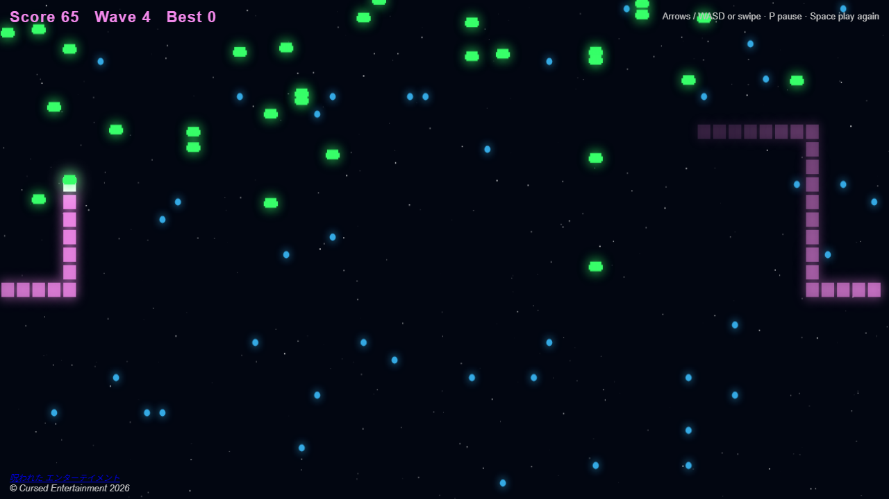
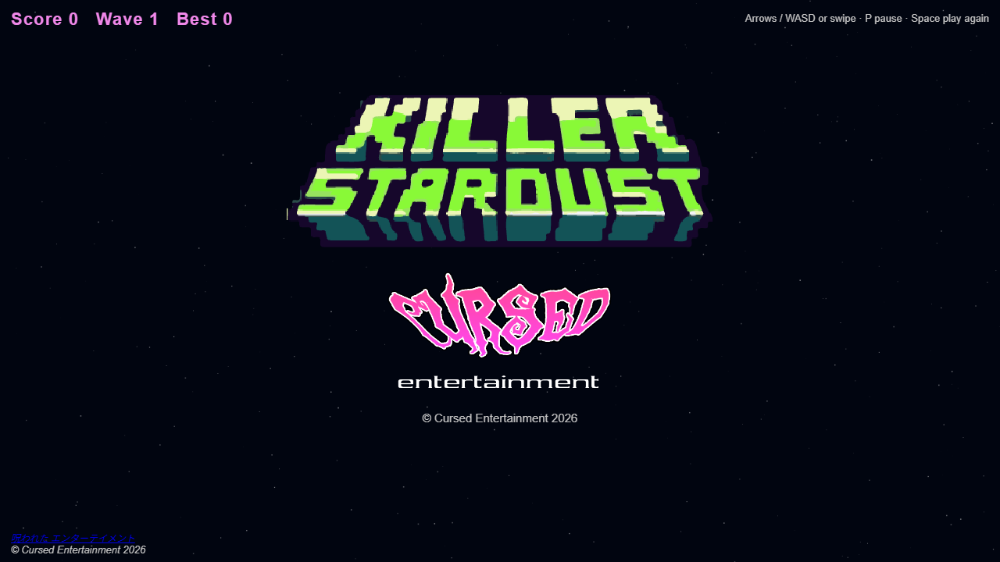
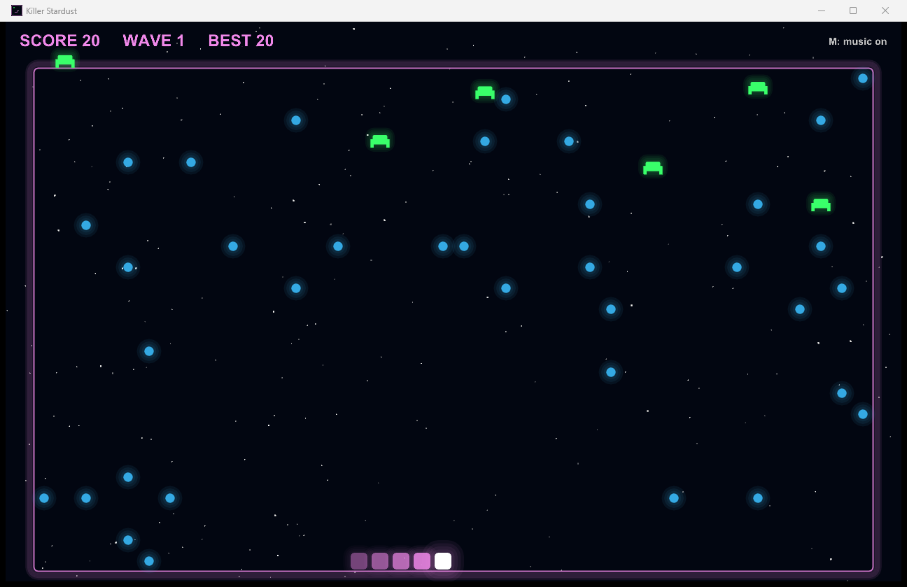

 

  

   

 

  
  
  

  
  
  
  
  
  
   

# Killer Stardust

**Play it:** https://killer-stardust.netlify.app/ · **[Windows exe](https://github.com/CursedPrograms/killer-stardust/releases/latest)** · **An Arcade Phantasm game**

Steer the comet through space, eat the stardust to grow your tail, and dodge the invaders that fall in waves, faster
every time. An invader through your tail **cuts it there**: everything behind the cut is gone, and so are the points it earned. One on your comet's
head, or running into your own tail, and it's over.

## Play

| Key | Does |
| --- | --- |
| Arrows or WASD (swipe on a phone) | steer |
| P | pause |
| Space, R or a tap | play again after a game over |

The splash (the Killer Stardust and Cursed logos) waits for a key or a tap, which also starts the music. Your best
score is kept in the browser.

## The look

Glowing blocks in the Cursed colours (a pink comet with a white head, blue stardust, acid-green invaders) over a
twinkling starfield. Put a space picture at `images/space-bg.jpg` and it goes behind everything, darkened a little so
the glow reads.

The page is `index.html` with `index.css`; the game is `scripts/gameplay.js`, the theme `scripts/background_music.js`, the sound effects `scripts/sfx.js` (made with Web Audio, no files).

## Versions

| | |
|---|---|
| **Browser** | this folder: [killer-stardust.netlify.app](https://killer-stardust.netlify.app/) |
| **Windows exe** | `cpp/`: download `KillerStardust-win64.zip` from the [latest release](https://github.com/CursedPrograms/killer-stardust/releases/latest), unzip, run `KillerStardust.exe` |
| **Android** | `android/`: coming |
| **PulseAmp** | a version built into [PulseAmp](https://github.com/CursedPrograms/PulseAmp-Media-Player)'s games, moving with your music |

### The Windows exe

C++17 with SDL2, OpenGL 3, [Dear ImGui](https://github.com/ocornut/imgui) and [stb](https://github.com/nothings/stb).
The theme is listened to as it plays: its loudness makes the stars twinkle, its bass makes the arena's edge glow,
and on its beats an extra invader drops in. Arrows / WASD steer, P pause, M music, F11 fullscreen, Esc menu.

To build it: Visual Studio 2022 (C++) and CMake, then `cpp/build.bat` (or `build.ps1`; `build.sh` on Linux with
SDL2 installed). It fetches SDL2 once into `cpp/external/`, builds `cpp/build/Release/KillerStardust.exe` and packs
`cpp/dist/KillerStardust-win64.zip`. The code: `cpp/src/main.cpp` (window, splash, HUD), `game.cpp` (rules, drawing,
sparks), `audio.cpp` (theme, beat listener, sound effects).

  <a href="https://www.youtube.com/watch?v=7ybDTxmQgUs" target="_blank">Gameplay video (an earlier version)</a>

 

© Cursed Entertainment 2026

 

